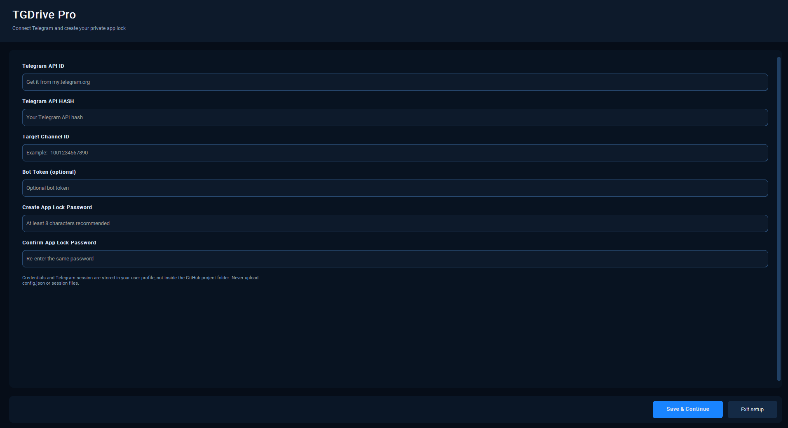
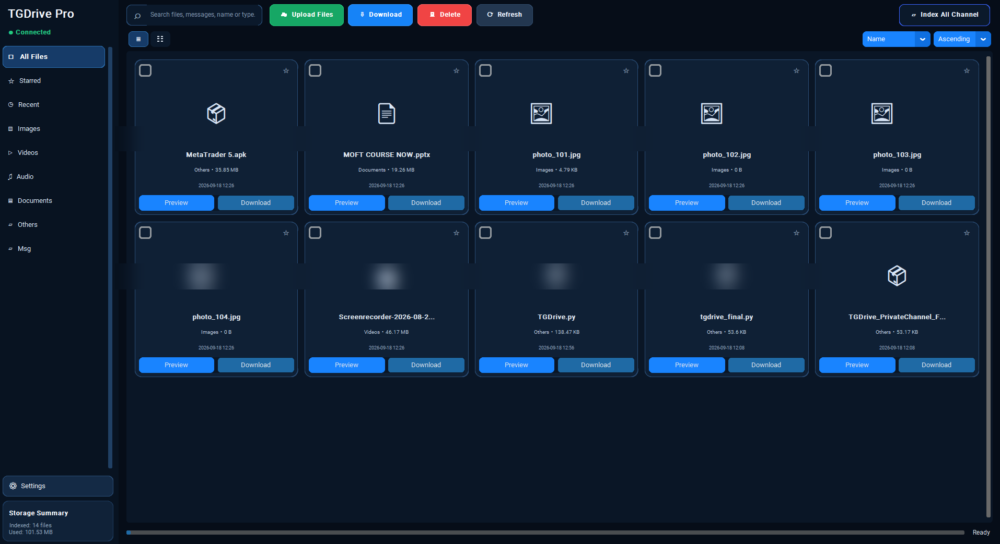
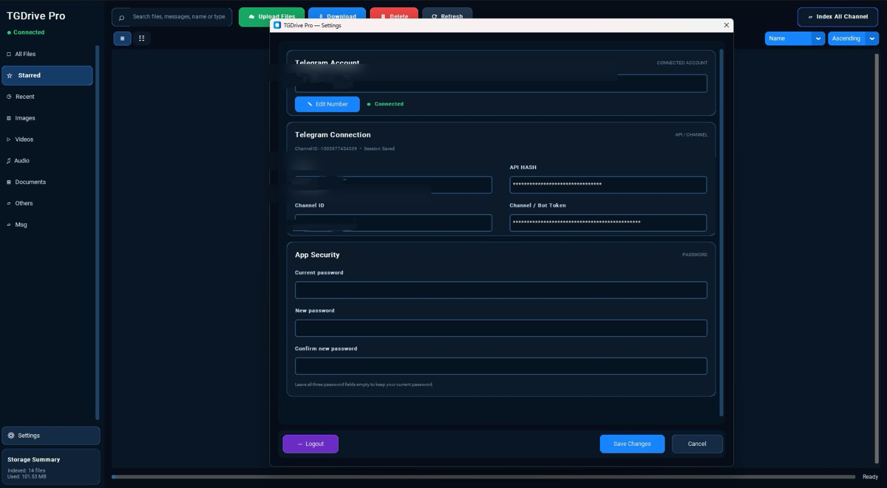
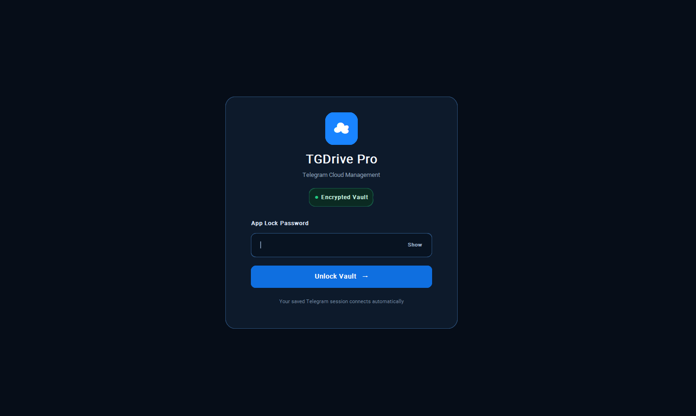

# TGDrive Pro

TGDrive Pro is a desktop Telegram cloud-file manager built with Python, CustomTkinter, Telethon and SQLite.

## Features

- Telegram account login with verification code and optional Telegram 2-step verification
- Restore an existing Telegram session on the next launch
- Upload and download files to/from the configured Telegram channel
- File categories, folders, favorites, recent items and message indexing
- Search, sorting, grid/list views and file previews where supported
- Dark navy/blue desktop interface with themed setup, login, settings and confirmation dialogs
- Optional drag-and-drop support

## Screenshots

### First-run setup


### Main dashboard


### Settings


### App lock screen


## Requirements

- Python 3.10 or newer
- A Telegram API ID and API hash from [my.telegram.org](https://my.telegram.org)
- Access to the Telegram channel configured in the first-run setup
- Tkinter installed for your Python distribution

## Windows setup

1. Install Python 3.10+ from [python.org](https://www.python.org/downloads/). During installation, enable **Add Python to PATH**.
2. Extract or clone this repository.
3. Double-click `run_windows.bat`, or run:

   ```powershell
   py -3 -m venv .venv
   .venv\Scripts\activate
   python -m pip install --upgrade pip
   pip install -r requirements.txt
   python TGDrive.py
   ```

## macOS setup

Install Python 3.10+ and ensure Tcl/Tk is available. From Terminal:

```bash
python3 -m venv .venv
source .venv/bin/activate
python -m pip install --upgrade pip
pip install -r requirements.txt
python TGDrive.py
```

## Linux setup

Install Python, pip, venv and Tkinter using your distribution's package manager. On Debian/Ubuntu:

```bash
sudo apt update
sudo apt install python3 python3-venv python3-pip python3-tk
```

Then run:

```bash
chmod +x run_unix.sh
./run_unix.sh
```

## First launch

The first launch opens the branded setup window. Enter:

1. Telegram API ID
2. Telegram API hash
3. Target channel ID (usually in `-100...` format)
4. Optional bot token
5. A new app-lock password and its confirmation

The app then asks for your Telegram phone number and verification code if no valid saved session exists. If Telegram 2-step verification is enabled, it will ask for that password too.

